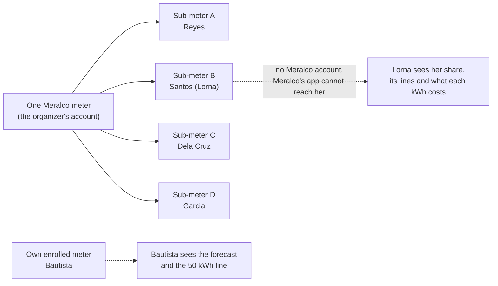
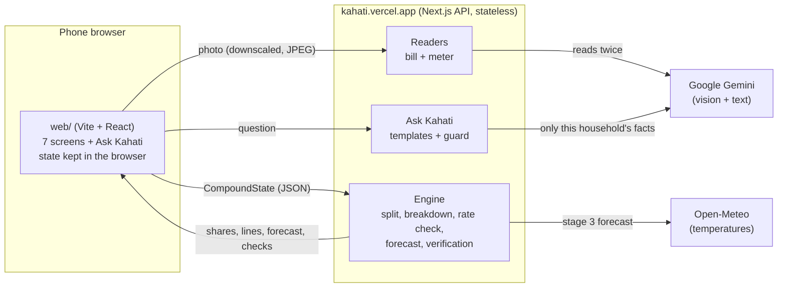
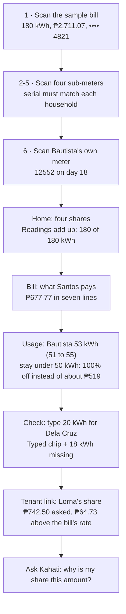
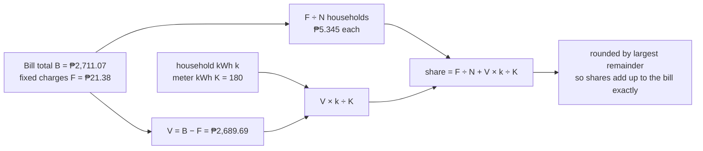
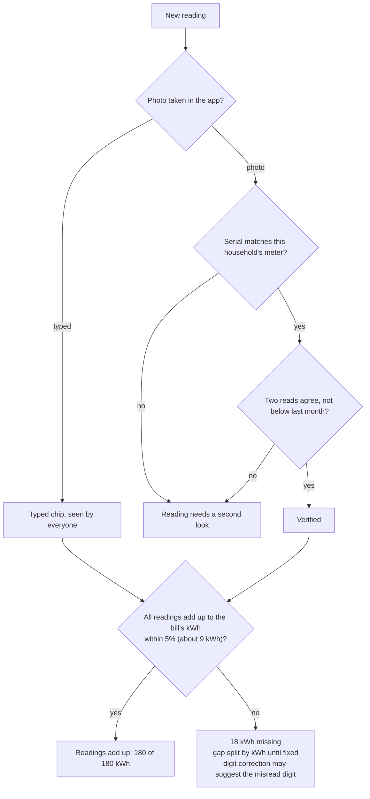
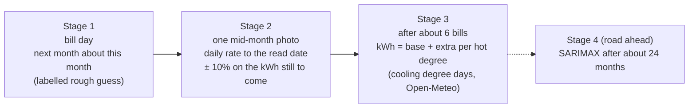
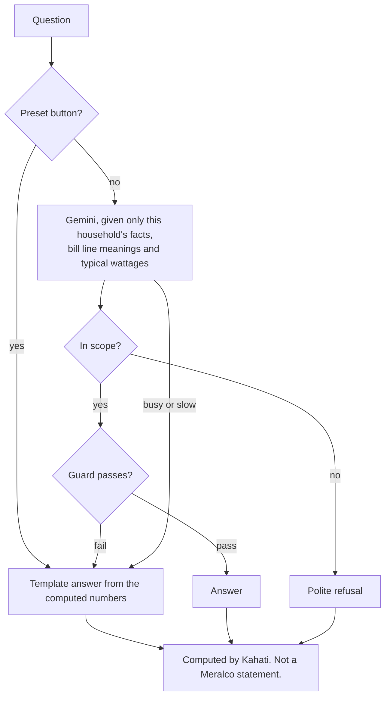
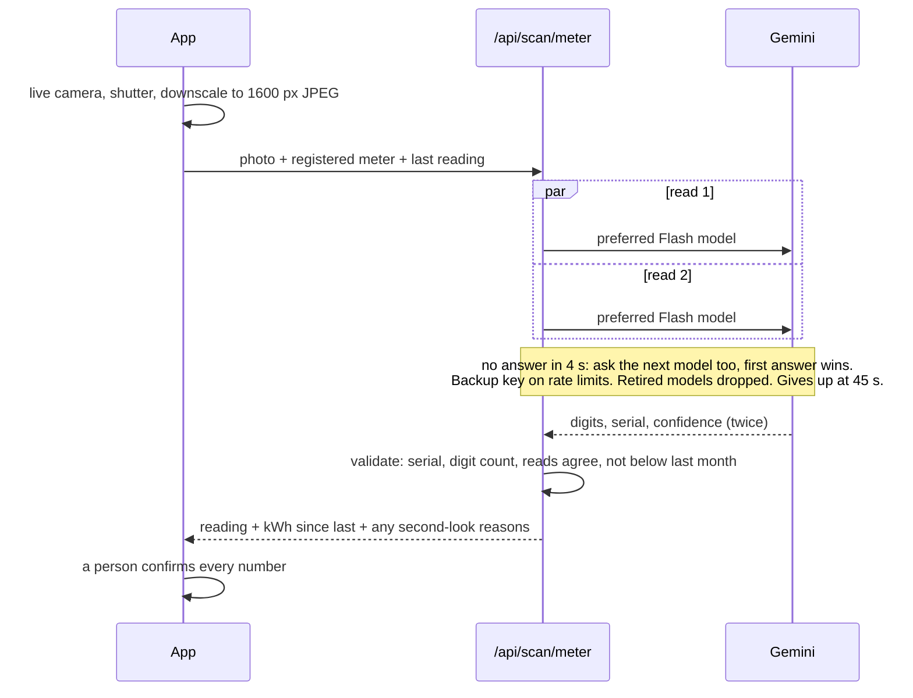

# Kahati

**Know your bill, manage your usage.** IDOL Hackathon 2026, Challenge 2, Team New York Style Pizza.

Kahati shows any household, including the ones behind someone else's meter, what their electricity bill is made of and what each kWh costs them. A household on its own enrolled meter is warned before it crosses the 50 kWh line where the lifeline discount drops.

| | |
|---|---|
| App (phone browser) | https://kahati-app.vercel.app |
| API | https://kahati.vercel.app ([contract](docs/API.md)) |
| Tenant view example | https://kahati-app.vercel.app/t/demo-santos |

> **All data in this repo is sample data.** Invented households and a sample bill, drawn as printable props. Computed by Kahati. Not a Meralco statement.

## Who it is for



- **Shared meter (the way in):** tenants pay through someone else's account. Kahati splits the bill fairly, shows each household what it pays for, and checks the readings against the bill.
- **Own meter:** the same engine gives one household its bill breakdown, a usage forecast and the lifeline warning.

## How it works



The API keeps no database. The app holds the month's state (bill, readings) in the browser and sends it with every call, so any server instance can answer and nothing about a household is stored on the server. Photos are read and discarded.

## The demo path



## The split



| Household | kWh | Share |
|---|---|---|
| Reyes | 52 | ₱782.36 |
| Santos (Lorna) | 45 | ₱677.77 |
| Dela Cruz | 38 | ₱573.17 |
| Garcia | 45 | ₱677.77 |
| **Total** | **180** | **₱2,711.07** |

Each household's share is also broken into the bill's seven lines (generation, transmission, system loss, distribution, supply and metering, taxes, other). Plain rounding would give ₱2,711.08; largest-remainder rounding keeps the total exact. Each kWh saved on the shared meter takes about ₱15 (₱14.94) off a share.

## How nobody fakes a share

The realistic cheat is under-reporting kWh to pay less, which pushes cost onto the neighbours. Every check is anchored to the bill Meralco already prints.



Also: reading dates are aligned to the bill's read date, self-declared common-area use is capped and shown, the bill's own rate is checked against Meralco's published rate, and two people see every reading. Kahati shows a gap and never guesses its cause; it reports nothing to Meralco.

## The forecast, in stages



Bautista: 32 kWh by day 18, so 1.78 kWh a day, 12 days left, 53 kWh by 30 Nov (51 to 55). The lifeline tiers (2026, DSWD) are 100% off up to 50 kWh, 35% to 70, 20% to 100. Pesos use the published Meralco rate from a team-updated table; before a month's rate is announced, last month's rate is used and labelled. Kahati never forecasts the rate.

## Ask Kahati (grounded chat)



The guard lets an answer through only if every number comes from the household's facts, it names no other household, makes no blame, legal or Meralco claims, has no links, and uses Latin script only. Preset answers are instant and the same every time.

What the organizer charged, refunds, rules and authorities are never discussed in free text; they stay on the reviewed rate-check template. The 4Ps flag and other households' names and kWh are never sent to Gemini.

## Reading the photos



Reading accuracy is measured on held-out real meter photos with `scripts/accuracy.ts` (exact match of every digit, reported as N of 50). The printed demo props never count toward that figure. See [`scripts/README.md`](scripts/README.md).

## Run it

Backend (this folder):

```bash
npm install
cp .env.example .env.local   # optional: add GEMINI_API_KEY and set READER=gemini
npm run dev                  # http://localhost:3000
npm test
```

Front end: see [`web/README.md`](web/README.md). Without `VITE_API_URL` it runs on a built-in mock of the sample compound.

Environment variables (backend, set in Vercel):

| Variable | Purpose |
|---|---|
| `READER` | `gemini` for real reading; anything else uses the mock reader |
| `GEMINI_API_KEY`, `GEMINI_API_KEY_2` to `_5` | Main key and automatic backups |
| `GEMINI_MODEL_FIRST` | Preferred model; others are still tried |
| `GEMINI_MODEL` | Pins a single model (no failover across models) |
| `TENANT_SECRET` | Signs tenant links (required in production) |

## Layout

```
docs/API.md          the API contract between backend and front end
src/app/api/         route handlers: sample, scan/bill, scan/meter, split, rate-check,
                     forecast, check, tenant-link, tenant/{token}, ask, ask/presets, health
src/lib/engine/      pure calculations: split, breakdown, rate check, forecast, verification
src/lib/readers/     bill and meter readers (mock, Gemini with key and model failover)
src/lib/ask/         Ask Kahati: context, templates, guard, Gemini call
src/data/            sample compound, rate table, lifeline tiers, typical wattages
src/e2e/             the 8-step demo path through the real route handlers
scripts/accuracy.ts  reading-accuracy harness for held-out photos
web/                 the phone-first front end (its own package.json)
```

## Libraries and APIs

Next.js, React, TypeScript, Vitest; Vite, React Router, GSAP, lucide-react, Inter Tight (front end). Google Gemini API (reading photos, Ask Kahati). Open-Meteo (temperatures, no key). Hosted on Vercel.

## What Kahati asks of Meralco

Nothing new. Its only input is the bill Meralco already prints: no API, no data request, no staff time. It never asks Meralco to verify, approve or discount anything.
