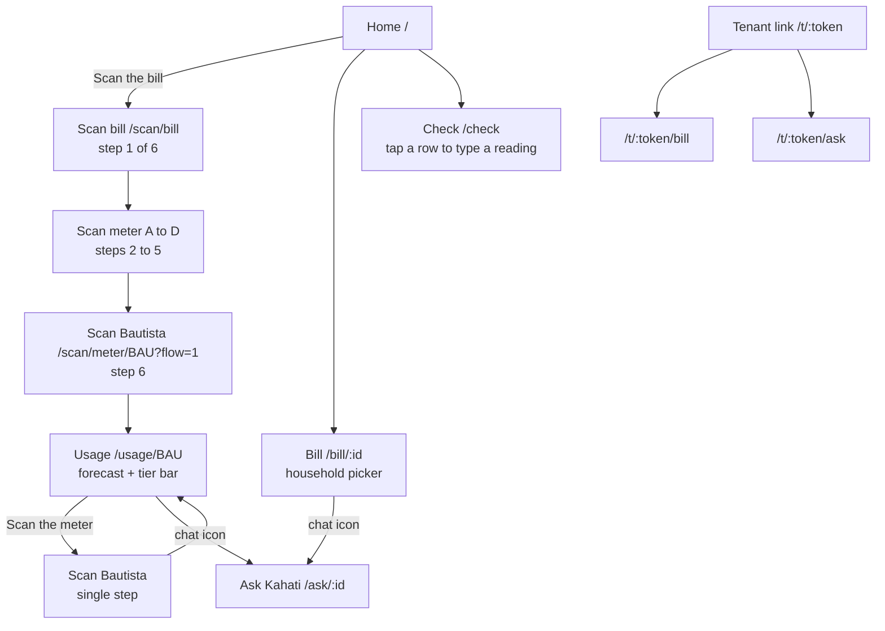
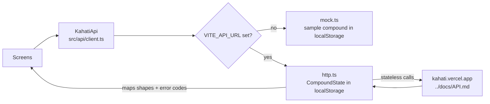

# Kahati (web)

Phone-first React + TypeScript front end for Kahati, IDOL Hackathon 2026, Challenge 2. Built with Vite. Design rules, decisions and open items for whoever works on it next: [`FRONTEND_NOTES.md`](FRONTEND_NOTES.md).

## Run

```bash
cd web
npm install
npm run dev
```

Open http://localhost:5173 at phone width (375 x 812; also check 375 x 667). On Vercel, deploy it as its own project with **Root Directory** set to `web`. Without `VITE_API_URL` the app runs on a **mock backend** holding the sample compound (sample data only, no real households).

To use the real backend, set `VITE_API_URL=https://kahati.vercel.app` in `.env.local` or in Vercel's environment variables (then redeploy). The API allows cross-origin calls.

With the real backend, `src/api/http.ts` keeps the compound's state in the browser (localStorage) and sends it to the stateless endpoints in `../docs/API.md`. "Reset demo" in the Home menu (the "⋯" button) clears it. A demo clock stamps confirmed readings on the sample bill's read date (31 Oct) so the read-date alignment does not pro-rate them; set `VITE_DEMO_CLOCK=off` for real, current bills.

Note for the demo: after the step 7 cheat (Dela Cruz typed at 20 kWh), the gap rule splits the missing 18 kWh by kWh. The organizer's Bill for Santos, and any Share link made during the gap, read ₱752.48 until the reading is fixed. The demo link `/t/demo-santos` falls back to the sample while the readings do not add up, so step 8 still shows ₱677.77. Mint the Share link before the cheat, or retype Dela Cruz (02238) first.

Dev-only shortcuts ("Use the sample bill (mock)", "Use the sample meter (mock)") show only on the local dev server with the mock (`showDevTools` in `src/api/index.ts`), never in a deployed build. "Load the rest" on Home stays in mock mode for demo step 3.

## Screens and routes

| Route | Screen | Bar |
|---|---|---|
| `/` | Home (organizer): bill, shares, readings status, rate note | yes |
| `/scan/bill` | Scan bill (consent, camera, "Type it instead"), a sheet over the current tab | no |
| `/scan/meter/:householdId` | Scan meter (serial match, confirm, edit, second-look reasons), same sheet | no |
| `/bill/:householdId` | What a household pays (7 bill lines, stacked bar) | yes |
| `/usage/:householdId` | Usage: own meter (`BAU`, chart, lifeline tier bar) or shared (`A` to `D`, per-kWh value) | yes |
| `/check` | Verification (tap a row to type a reading; "Typed" chip, gap, tolerance) | yes |
| `/ask/:householdId` | Ask Kahati chat about one household | no |
| `/t/:token` | Tenant view (`/t/demo-santos`) | no |
| `/t/:token/bill` | Tenant's bill lines | no |
| `/t/:token/ask` | Ask Kahati from the tenant link | no |

Scan routes render in `ScanOverlay`, a sheet that slides up over the last tab, so the tab bar is covered, never removed.

### Screen flow



### Data flow



## Code map

```
src/
  main.tsx            routes, splash, scan overlay
  index.css           design tokens and all styles (one file)
  api/                KahatiApi interface (client.ts), types, mock.ts, http.ts (real backend), index.ts (picks one)
  i18n/copy.tsx       every UI string in English and Filipino, useT(), useErrText()
  lib/                format (pesos, dates, Filipino months), lifeline tiers, useAsync (+ cache, notifyChange)
  components/         Shell (tab bar + notch), ScanOverlay, Scan, Splash, Skeletons, UsageChart, LifelineBar, motion, ui
  screens/            Home, ScanBill, ScanMeter, Bill, Usage, Check, Tenant, Ask
```

## Backend contract

The front end talks only to `src/api/client.ts` (`KahatiApi`). Types are in `src/api/types.ts`. HTTP calls live in `src/api/http.ts`, wired to the endpoints in `../docs/API.md`.

- Money: pesos as unrounded numbers. Shares already rounded by largest remainder.
- Dates: `YYYY-MM-DD`; timestamps ISO.
- Uploads: photos are downscaled in the browser and sent as base64 JSON.
- Errors: the API returns `{error:{code,message,next}}`. `http.ts` maps backend codes to UI codes (`BACKEND_CODES`); `ApiError.code` is shown through `err.<code>` in `i18n/copy.tsx` in either language. Uncoded errors show the backend's English message in English and a Filipino fallback in Filipino.
- Meter scans carry `issues` (backend issue codes); the reading card shows `issue.<code>` text after "Reading needs a second look".

## Libraries

React, React Router, GSAP (+ `@gsap/react`, ScrollToPlugin), lucide-react (icons), Inter Tight (Google Fonts).
